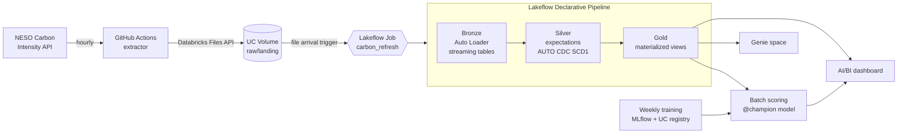
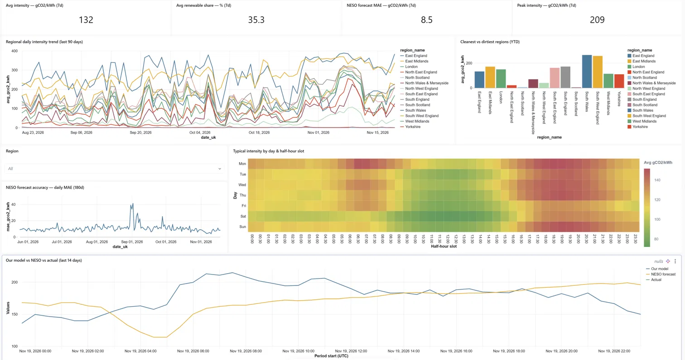

# GB Grid Carbon Lakehouse

An end-to-end Databricks lakehouse on half-hourly carbon intensity data for the GB electricity grid. It identifies **when and where electricity is cleanest**, measures **how accurate the official forecast is**, and trains and benchmarks a **24-hour-ahead forecast model**.

**Stack:** Databricks (Unity Catalog, Lakeflow Spark Declarative Pipelines, Auto Loader, AUTO CDC, Lakeflow Jobs, MLflow, AI/BI), PySpark, Terraform, Databricks Asset Bundles, GitHub Actions.

**Data:** [NESO Carbon Intensity API](https://carbonintensity.org.uk/), CC BY 4.0.

---

## Business questions

1. What is the greenest half-hour to use electricity in each region, by weekday?
2. Which regions are cleanest and dirtiest, and how strongly does wind share drive intensity?
3. How accurate and how biased is the official NESO forecast?
4. How does a history-only model compare with persistence and NESO baselines?

## Architecture



Extraction runs in GitHub Actions and pushes files into a Unity Catalog Volume, because Databricks Free Edition restricts outbound internet access. New files fire a file arrival trigger, so processing is event-driven. On a workspace with internet access, the same extractor runs as a Databricks job (`carbon_extract_in_workspace`).

## Dashboard



## Results

| Metric | Value |
|---|---|
| Regional half-hourly records (silver, 2024 onwards) | 851,105 |
| Regions | 14 DNO regions + England, Scotland, Wales |

24-hour-ahead national forecast, last 30 days (1,440 half-hours):

| Approach | MAE (gCO2/kWh) |
|---|---|
| NESO forecast | 7.8 |
| Persistence (same time yesterday) | 30.5 |
| History + calendar model (HistGradientBoosting) | 36.2 |

Without weather inputs, the model does not beat persistence. Day-ahead intensity is driven mainly by wind and solar output, which past intensity can't predict. The NESO figure uses the latest revised forecast held for each period, so it is an optimistic upper bound. Bronze keeps every extracted forecast version, so a true 24-hour-ahead NESO comparison becomes possible as hourly extracts build up. Weather forecast features are the planned next improvement.

## Data model

| Layer | Table | Grain | Notes |
|---|---|---|---|
| Bronze | `bronze.{regional_intensity,national_intensity,national_generation}_raw` | landed file | Append-only; every forecast revision retained |
| Silver | `silver.regional_intensity` | region × half-hour | AUTO CDC SCD1, latest forecast |
| Silver | `silver.regional_generation_mix` | region × half-hour × fuel | |
| Silver | `silver.national_intensity` | half-hour | Forecast and actual |
| Silver | `silver.national_generation_mix` | half-hour × fuel | |
| Silver | `silver.dim_region` | region | |
| Gold | `gold.fact_regional_halfhour` | region × half-hour | Intensity, fuel mix, renewable/low-carbon share, UK time |
| Gold | `gold.region_daily_summary` | region × UK day | |
| Gold | `gold.greenest_slots` | region × weekday × slot | Last 90 days |
| Gold | `gold.national_halfhour` | half-hour | ML base table |
| Gold | `gold.national_forecast_accuracy` | UK day | MAE, MAPE, bias |
| ML | `ml.forecast_predictions` | half-hour × scoring run | Appended per run |
| ML | `ml.carbon_intensity_forecaster` | model | `@champion` / `@challenger` aliases |

Column definitions: [docs/data_dictionary.md](docs/data_dictionary.md).

## Repository layout

```
config/endpoints.yml               endpoint configuration for ingestion
src/carbon_lakehouse/              shared library (unit-tested)
src/extract/extract_to_volume.py   API -> UC Volume extractor
src/pipelines/                     bronze, silver, gold pipeline definitions
src/ml/                            training and batch scoring
src/sql/                           dashboard queries, setup SQL, Genie instructions
resources/                         bundle resources: pipeline and jobs
databricks.yml                     bundle root with dev/prod targets
infra/terraform/                   catalogs, schemas, volumes, grants
.github/workflows/                 CI, CD and scheduled extract
tests/                             pytest suite with JSON fixtures
docs/                              data dictionary, runbook
```

## Setup

Prerequisites: a Databricks workspace (Free Edition works), Python 3.10+, Java 17+ for local Spark tests, Terraform, and the Databricks CLI.

```bash
python -m venv .venv && source .venv/bin/activate      # Windows: .venv\Scripts\activate
pip install -e ".[dev,extract]"
pytest -q

databricks auth login --host https://<workspace>.cloud.databricks.com --profile carbon
export DATABRICKS_CONFIG_PROFILE=carbon                 # Windows: $env:DATABRICKS_CONFIG_PROFILE="carbon"
```

1. **Platform.** Create catalogs `carbon_dev` and `carbon_prod` in the Catalog UI (default storage), then apply Terraform, which imports them and creates the schemas and volumes:
   ```bash
   terraform -chdir=infra/terraform init
   terraform -chdir=infra/terraform apply
   ```
2. **Backfill:**
   ```bash
   python src/extract/extract_to_volume.py --mode sdk --volume-root /Volumes/carbon_dev/raw/landing --start 2024-01-01 --end 2026-01-01
   ```
3. **Deploy and run:**
   ```bash
   databricks bundle deploy -t dev
   databricks bundle run carbon_pipeline -t dev
   databricks bundle run carbon_train -t dev
   databricks bundle run carbon_refresh -t dev
   ```
4. **Automate.** Add `DATABRICKS_HOST` and `DATABRICKS_TOKEN` as GitHub Actions secrets. `extract.yml` then runs hourly, and `deploy.yml` deploys prod on merge to `main`.

## Design decisions

| Decision | Rationale |
|---|---|
| Extract outside Databricks, push into a volume | Works within Free Edition network limits; separates extraction from processing |
| Config-driven endpoints | New feeds need configuration only, not code |
| 48h overlap re-pulls + AUTO CDC SCD1 | Captures forecast revisions and late actuals; silver holds the latest version, bronze holds all versions |
| Unique, never-overwritten landing files | Full audit trail; exactly-once processing with Auto Loader |
| Single pipeline across three schemas | Simpler lineage; fits the Free Edition pipeline limit |
| Explicit bronze schemas with rescue mode | Predictable types; unexpected fields go to `_rescued_data` |
| Pure transformation functions in a library | Business logic is unit-tested independently of the pipeline runtime |
| All lag features ≥ 48 periods | No leakage into the 24-hour forecast horizon |
| Champion/challenger aliases | A new model is promoted only if it beats the current one |
| Catalogs imported into Terraform with `prevent_destroy` | Default-storage catalogs are UI-created; Terraform manages them safely |

## Attribution

Carbon intensity data © NESO, licensed under CC BY 4.0.

Documentation, code formatting and comments added by Claude.

